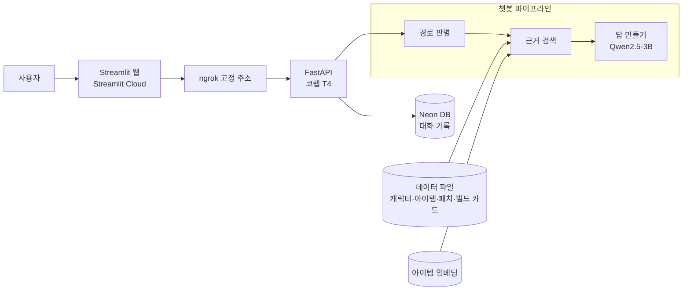

# Genshin Build Alchemist

**원신 데이터를 근거로 답하는 한국어 RAG 챗봇**
캐릭터 정보, 무기·성유물, 패치 변경, 빌드 추천을 묻고 답합니다. 근거가 없으면 지어내지 않고 "찾지 못했어요"라고 답합니다.


[](https://colab.research.google.com/github/genshin-build-alchemist/genshin-build-alchemist/blob/main/notebooks/run_chatbot.ipynb)

> 팀 Temp:ZERO · P1 RAG 챗봇 기본 프로젝트 (2026.11.04 ~ 12.01)
> 시연 영상: 추가 예정

## 목차

1. [기술 스택](#기술-스택)
2. [프로젝트 소개](#프로젝트-소개)
3. [진행 현황](#진행-현황)
4. [결과](#결과)
5. [시스템 구조](#시스템-구조)
6. [실행하기](#실행하기)
7. [폴더 구조](#폴더-구조)
8. [데이터](#데이터)
9. [다음 계획](#다음-계획)
10. [팀과 작업 방식](#팀과-작업-방식)

## 기술 스택

| 영역 | 사용 기술 | 고른 이유 |
|---|---|---|
| 언어 모델 | Qwen2.5-3B-Instruct | 한국어 답변 가능, 무료 코랩 T4에서 fp16으로 실행 |
| 임베딩 | granite-embedding-311m-multilingual-r2 | 다국어 768차원, 아이템 벡터 검색 |
| 검색 | 규칙 기반 경로 판별 + 이름·키워드 매칭 + 벡터 검색 | 질문 종류마다 맞는 근거를 정확히 찾기 |
| API | FastAPI + uvicorn | `POST /ask`, `GET /health` |
| 웹 화면 | Streamlit (Streamlit Cloud) | 채팅 화면, 빌드 카드, 결과 대시보드 |
| DB | Neon PostgreSQL (pgvector 스키마) | 대화 기록 자동 저장 |
| 실행·배포 | Google Colab T4 + ngrok 고정 주소 | GPU 서버를 웹 화면과 연결 |
| 데이터 | [genshin-db](https://github.com/theBowja/genshin-db) (MIT) 한국어 | 깃 이력으로 버전별 패치 변경 추출 |
| 테스트 | Python unittest (183개) | PR마다 전체 통과 확인 |

## 프로젝트 소개

원신은 업데이트가 잦아서 예전 정보가 금방 틀린 정보가 되고, 일반 LLM에 그냥 물으면 그럴듯하게 지어냅니다 (근거 없이 물었을 때 환각률 91.8%). 그래서 **데이터에 있는 것만, 근거와 함께 답하는 챗봇**을 만듭니다.

- **근거가 없으면 모델을 부르지 않습니다.** 질문에 맞는 근거를 먼저 찾고, 없으면 바로 "찾지 못했어요"라고 답합니다.
- **사실은 데이터 그대로, 모델은 설명만.** 신규 캐릭터 목록이나 빌드 추천 목록은 데이터에서 그대로 꺼내고, 모델은 요약과 이유만 씁니다.
- **같은 평가셋으로 단계별 비교.** baseline → prompt_v2 → rag → rag_v3 → rag_v4 순서로 개선하고 매 단계 같은 문항으로 잽니다. LoRA 파인튜닝은 하지 않고 프롬프트와 검색으로 개선합니다.

## 진행 현황

| 날짜 | 한 일 |
|---|---|
| 10/30 | 저장소 뼈대와 작업 규칙 (브랜치·PR·결과 저장 위치) |
| 11/03 | 평가셋 info_v1 고정, 평가 노트북 (팀 드라이브 연동) |
| 11/04 ~ 11/09 | 조회 → 조건 → 패치 → 빌드 경로 구현, API·웹 화면·Neon DB 대화 기록 연결 |
| 11/05 | 프롬프트 개선 rag_v4 |
| 11/06 | 배포 방식(Streamlit Cloud + 코랩 서버), 저장소 공개, 매일 10시 회의 결정 |
| 11/10 | 데이터를 7.2로 갱신, 패치 변경 5.0~7.2 (표기만 바뀐 기록 자동 제외), 평가셋 info_v2로 6방법 재실행 |
| 11/11 | 아이템 벡터 검색 구현·연결, 실행 노트북, 오류 분석 (남은 오류의 원인이 검색 잡음임을 확인) |
| 11/13 | 기획안 발표 |
| 12/01 | 최종 발표 |

- [x] 데이터 수집·전처리 (원신 7.2)
- [x] 6경로 챗봇 (조회, 조건, 패치, 아이템, 빌드, 모름)
- [x] API, 웹 화면, 대화 기록 저장, 코랩 시연 서버
- [x] 고정 평가셋과 단계별 실험 (baseline ~ rag_v4)
- [ ] 결과 대시보드, 개선 전후 오류 분석표
- [ ] rag_v5 (검색 다듬기)
- [ ] 시연 영상

## 결과

고정 평가셋 info_v2 (628문항: 평가 121, 학습 507 중 DEV 60), 모델 Qwen2.5-3B

| 방법 | 정답률 (DEV) | 환각률 (DEV) | 바꾼 것 |
|---|---|---|---|
| baseline | 0.0% | 91.8% | 질문만 넣음 (일반 LLM) |
| prompt_v2 | 6.7% | 87.5% | 규칙 + 예시, 근거 없음 |
| rag | 36.7% | 8.8% | 키워드 검색 근거 추가 |
| rag_v3 | 45.0% | 7.9% | 예시에도 근거를 붙임 |
| **rag_v4 (지금 챗봇)** | **71.7%** | 8.9% | 근거 읽는 법·조건 규칙 추가 |

- rag_v4 + 후처리 macro F1: DEV 0.796, **평가 121문항 0.817** (평가 문항은 마지막에 한 번만 돌림)
- 남은 환각 5건 중 4건이 조건 검색입니다. 근거로 넣은 캐릭터 중 조건을 모두 맞는 비율이 약 13%라, 원인은 모델보다 **검색 잡음**에 가깝습니다.
- 지표 정의와 사례는 `docs/aux_metrics.md`, 결과 JSON은 드라이브 `results/`에 있습니다. 7.1 데이터의 info_v1 결과와는 점수를 직접 비교하지 않습니다.

## 시스템 구조



| 경로 | 예시 질문 | 근거 | 답 만드는 법 |
|---|---|---|---|
| 조회 | 알베도 원소가 뭐야? | 그 캐릭터 문서 1개 | 모델(rag_v4)이 근거 안에서 답 |
| 조건 | 몬드 출신 5성 캐릭터 누구 있어? | 조건에 맞는 캐릭터 최대 30명 | 모델(rag_v4)이 근거 목록에서 고름 |
| 패치 | 7.0에서 사유 뭐 바뀌었어? | 그 버전의 변경 기록 | 신규 목록은 데이터 그대로, 요약만 모델 |
| 아이템 | 치명타 올려주는 활 뭐 있어? | 이름이 있으면 그 문서, 없으면 벡터 검색 상위 5개 | 모델이 문장으로 답 |
| 빌드 | 알베도 추천 성유물은? | 빌드 카드 + 무기·성유물 정보 | 추천 목록은 카드 그대로, 이유만 모델 |
| 모름 | 원신에서 제일 센 캐릭터는? | 없음 | **모델을 부르지 않고** "찾지 못했어요" |

<details>
<summary>API 응답 형식 (POST /ask)</summary>

```json
{
  "question": "7.0에서 사유 뭐 바뀌었어?",
  "route": "patch",
  "answer": ["고유 특성 1", "명의 자리 4"],
  "message": "7.0 버전 사유의 바뀐 부분: 고유 특성 1, 명의 자리 4",
  "evidence": [{"kind": "patch", "title": "사유", "doc_id": "patch:7.0:constellations:sayu", "text": "7.0 사유: 명의 자리 수정, 바뀐 부분 = 명의 자리 4"}],
  "found": true,
  "needs_recheck": false,
  "model": "mock-rule",
  "method": "rag",
  "data_version": "8e5badd 2026-11-04 7.2 actual"
}
```

- `answer`는 평가(F1 채점)와 같은 목록, 화면에는 `message`를 보여 줍니다.
- `evidence[].doc_id`는 검색 문서 id입니다. 빌드 카드·재확인 표시처럼 문서가 아닌 근거는 `null`입니다.
- 칸 이름은 바꾸지 않고 필요하면 **추가만** 합니다.

</details>

## 실행하기

**코랩 (실제 모델)**: 위 Colab 배지로 `notebooks/run_chatbot.ipynb`를 열고 런타임 → 모두 실행합니다.
모델·아이템 벡터 검색 불러오기 → 대표 질문 점검(✓/✗) → API 서버 + ngrok 시연 주소까지 한 번에 뜹니다 ([notebooks/README.md](notebooks/README.md)).
코랩 보안 비밀에 `NGROK_TOKEN`, `NGROK_DOMAIN`(고정 주소), `DATABASE_URL`(대화 기록)을 넣습니다.

**로컬 (GPU 없이, 모의 답변기)**: 근거에서 규칙으로 답을 뽑는 가짜 모델로 전체 흐름을 확인합니다.

```bash
pip install -r requirements.txt && python3 -m unittest discover -s tests -t . && uvicorn api.main:app --reload
```

http://127.0.0.1:8000/docs 에서 `/ask`에 질문을 보내 볼 수 있습니다.

<details>
<summary>내 PC에서 실제 모델로 띄우기 (맥 애플 실리콘, 메모리 8GB 이상)</summary>

```bash
pip install -r requirements.txt -r requirements-llm.txt && GBA_ANSWERER=llm uvicorn api.main:app
```

- `GBA_ANSWERER`가 `mock`(기본)이면 모의 답변기, `llm`이면 Qwen2.5-3B + rag_v4 + 후처리(평가 0.817과 같은 설정)입니다. 설정은 `core/llm.py` 맨 위에 있습니다.
- 처음 한 번은 모델(약 6GB)을 내려받습니다. `/health`의 `model`이 `Qwen/Qwen2.5-3B-Instruct`면 실제 모델로 뜬 것입니다.
- 맥은 장치가 `mps`로 잡혀서 코랩(T4)과 답이 드물게 다를 수 있습니다.

</details>

## 폴더 구조

```
genshin-build-alchemist/
├── data/          캐릭터·아이템(7.2), 패치 변경 기록, 검색 문서, 평가셋, 빌드 카드
├── collector/     genshin-db 깃 이력에서 패치 변경 추출, 표기만 바뀐 기록 거르기
├── core/
│   ├── router.py      경로 판별 (6개)
│   ├── retrieval.py   경로별 근거 검색
│   ├── vector.py      아이템 벡터 검색
│   ├── answer.py      모의 / LLM 답변기, 프롬프트, 후처리
│   ├── pipeline.py    위를 이어 붙인 ask()
│   └── ...            kb_data.py, documents.py, validate.py (데이터 생성·빌드 카드 검사)
├── api/           FastAPI, 대화 기록 저장
├── db/            PostgreSQL 스키마, 시드 SQL
├── demo/          Streamlit 웹 화면
├── dashboard/     결과 비교 대시보드
├── notebooks/     실행용 run_chatbot, 실험용 01~03 (평가, 모델 비교, 보조 지표)
└── tests/         테스트 183개
```

## 데이터

| 항목 | 규모 |
|---|---|
| 캐릭터 | 126명 |
| 무기 / 성유물 | 256개 / 63세트 |
| 패치 변경 기록 | 5.0 ~ 7.2, 325건 (깃 이력 453건 중 표기만 바뀐 128건 제외) |
| 검색 문서 | 1,696개 (HTML·색 코드 제거, 중복 처리) |
| 빌드 카드 | 21장 (팀이 직접 요약, 출처·확인 버전 기록) |

출처: [genshin-db](https://github.com/theBowja/genshin-db) (MIT) 한국어 데이터, 커밋 `8e5badd` (7.2). 최신 캐릭터 일부는 지역(8명)·원소(4명) 정보가 없어서 그 질문에는 답하지 않습니다.

<details>
<summary>패치 변경 기록·검색 문서 다시 만들기</summary>

```bash
cd collector && python3 collect_patchnotes.py --since 5.0 && cp out/patch_changes.json ../data/ && cd .. && python3 -m core.documents --fetch && python3 -m core.kb_data && python3 db/make_documents_seed.py && python3 db/make_seed.py
```

- 표기만 바뀐 변경(성우 정보, 5.6의 일반 공격 이름 표기 102건 등)은 자동으로 거릅니다 (`collector/patchnotes/noise.py`).
- genshin-db 커밋(`core/documents.py`의 `DATA_COMMIT`)을 바꾸면 평가셋도 새 버전으로 만듭니다 (`data/eval/README.md`).

</details>

<details>
<summary>빌드 카드 추가·검사</summary>

`data/build_cards/_template.json`을 복사해 `캐릭터키.json`으로 채운 뒤 `python3 -m core.validate`로 검사합니다 (이름 오타, 무기 종류 불일치, 빈 칸, 패치 후 재확인).
외부 가이드는 참고·링크만 하고 내용은 직접 요약합니다. `_`로 시작하는 파일은 양식이라 챗봇이 읽지 않습니다.

</details>

<details>
<summary>DB (Neon PostgreSQL)</summary>

```bash
python3 db/make_seed.py && python3 db/make_documents_seed.py && psql "$DATABASE_URL" -f db/schema.sql && psql "$DATABASE_URL" -f db/seed_characters.sql && psql "$DATABASE_URL" -f db/seed_documents.sql
```

- 표: `documents`(검색 문서), `chunks`(임베딩 `vector(768)`), `characters`, `chat_logs`(대화 기록)
- API는 `DATABASE_URL`이 있으면 질문마다 `chat_logs`에 저장하고, 없으면 건너뜁니다.
- 아이템 임베딩(319개)은 지금 드라이브 `data/embeddings/`에서 메모리로 올려 씁니다. 문서가 늘면 `chunks`(pgvector)로 옮깁니다. 자세한 건 [db/README.md](db/README.md).

</details>

## 다음 계획

**rag_v5: 검색 다듬기** (11/13 발표 후). 남은 오류 대부분이 검색 단계에서 생기므로 검색을 고칩니다.

1. 동의어·줄임 이름 표: 창 → 장병기, 카즈하 → 카에데하라 카즈하
2. 조건 검색: 조건을 모두 맞는 캐릭터만 근거로
3. 아이템: 무기 종류·주옵션·성급(기본 4~5성)으로 거른 뒤 벡터 점수 순 (지금은 3성이 많이 잡힘)
4. 빌드 이유: 카드 메모에 없는 빈말 막기

동의어가 들어간 말투 변형 질문을 더해 v4와 전후를 비교합니다.

## 팀과 작업 방식

| 이름 | 역할 |
|---|---|
| 이승우 | 데이터, 메인 코드(경로 판별·검색·파이프라인), 패치 변경, 발표 |
| 한동우 | 아이템 벡터 검색 |
| 임준규 | 모델 실험, 평가·보조 지표, 시연 서버 |
| 백수현 | 웹 화면, DB, 빌드 카드, 결과 대시보드 |

- main에 직접 push하지 않고, `파트/작업내용` 브랜치에서 PR로 합칩니다.
- PR 전에 `python3 -m unittest discover -s tests -t .`를 통과시킵니다.
- 할 일은 파일 안의 `TODO(A)` 같은 주석에 있습니다. 끝나면 `[x]`로 바꿔 같은 PR에 올립니다.
- 결과 JSON·모델 파일은 드라이브 팀 폴더에, 비밀값은 `.env`나 코랩 보안 비밀에만 둡니다.
- AI에게 작업을 시킬 때는 [docs/AI_CONTEXT.md](docs/AI_CONTEXT.md)를 맨 앞에 붙여 넣습니다.
